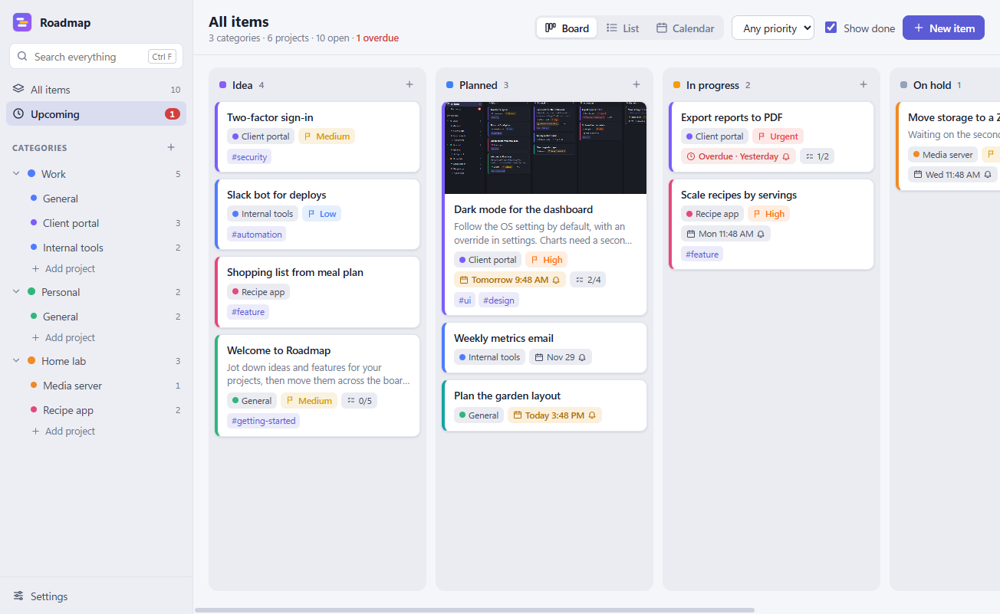
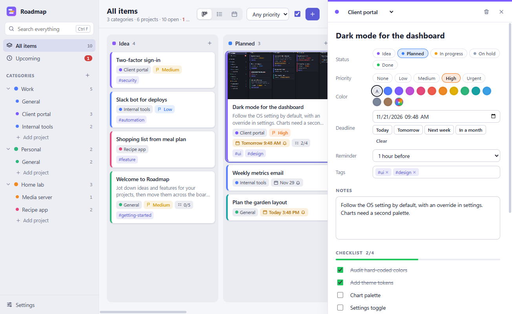
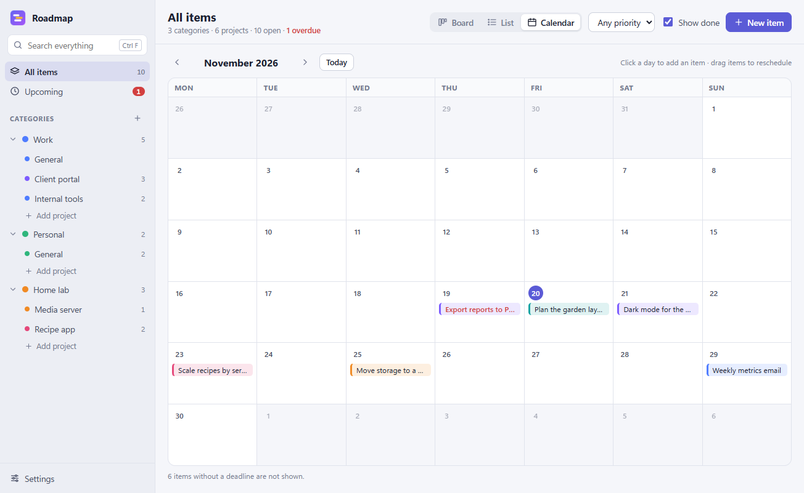
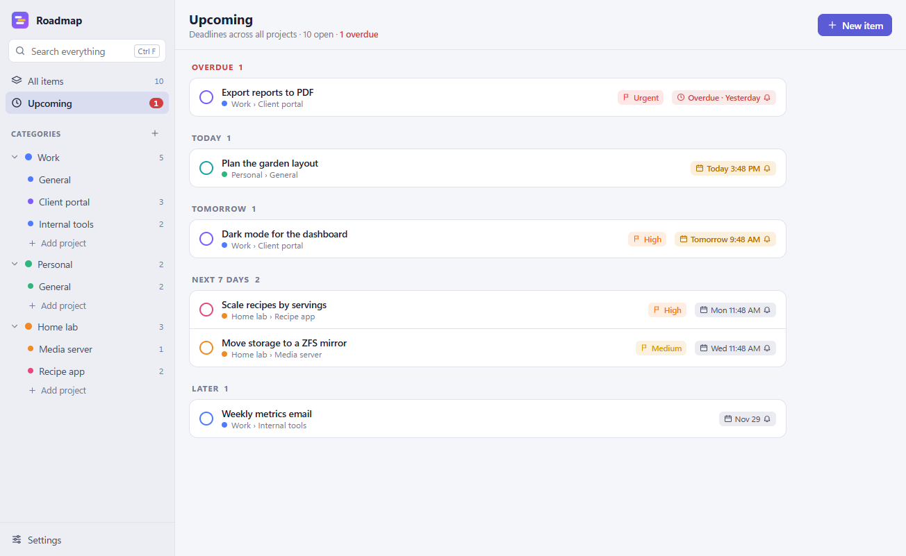

# Roadmap

A personal, offline roadmap for Windows. Use it to jot down ideas and features for your projects and follow them from idea to done.

<picture>
  <source media="(prefers-color-scheme: dark)" srcset="docs/screenshots/board-dark.png">
  
</picture>

## Screenshots

**Item editor:** status, priority, color, deadline and reminder, tags, notes, checklist and attached images.

<picture>
  <source media="(prefers-color-scheme: dark)" srcset="docs/screenshots/editor-dark.png">
  
</picture>

**Calendar:** drag items to another day to change their deadline.

<picture>
  <source media="(prefers-color-scheme: dark)" srcset="docs/screenshots/calendar-dark.png">
  
</picture>

**Upcoming:** deadlines across every project, grouped by when they're due.

<picture>
  <source media="(prefers-color-scheme: dark)" srcset="docs/screenshots/upcoming-dark.png">
  
</picture>

## Run it

```powershell
npm install
npm start
```

If `npm install` blocks Electron's download step, run `node node_modules/electron/install.js` once.

## Build an installer

```powershell
npm run dist
```

This writes two files to `dist/`:
- `Roadmap-Setup-x.y.z.exe`: an installer with Start menu and desktop shortcuts. The "start at sign-in" setting only works in the installed app.
- `Roadmap-Portable-x.y.z.exe`: a portable single file.

## Release on GitHub

GitHub Actions builds both files and publishes the release for you (see `.github/workflows/release.yml`):

1. Change `"version"` in `package.json` (for example to `0.2.0`). Optionally write release notes in `docs/release-notes/v0.2.0.md`. Then commit and push.
2. Create a tag that matches with a `v` in front (`v0.2.0`) and push the tag.
3. After a few minutes the release appears under **Releases** with both `.exe` files. Its description is your notes file (if there is one), followed by GitHub's auto-generated list of changes.

If the tag and the `package.json` version don't match, the build stops with an error. To build without publishing a release, open **Actions → Build and release → Run workflow** and download the files from the run's **Artifacts**.

## Features

- **Categories → Projects → Items.** Work and Personal are created for you; add as many categories and projects as you like.
- **Color coding.** Categories and projects have colors. Items inherit their project's color unless you give them their own.
- **Board, List and Calendar views**, plus an **Upcoming** page that groups deadlines into overdue, today, tomorrow, the next 7 days and later.
- **Statuses:** Idea, Planned, In progress, On hold, Done. Drag cards between columns. Drag a card onto a project in the sidebar to move it there.
- **Deadlines and reminders.** Windows notifications fire before the deadline and again when it's due. Click a notification to open the item. When you close the window, Roadmap stays in the system tray so reminders keep working.
- **Images.** Paste a screenshot (Win+Shift+S, then Ctrl+V) to attach it to the open item. With no item open, pasting creates a new idea from the screenshot. You can also drop image files onto a card or into the editor.
- **Priorities, tags, checklists and notes** on every item. Search covers all of them.
- **Light and dark themes** that follow Windows by default. You can override this in Settings.
- **Backups.** Export and import a single `.json` file that includes your images.

## Keyboard

| Keys | Action |
| --- | --- |
| Ctrl+N | New item |
| Ctrl+F | Search |
| Ctrl+1 / 2 / 3 | Board / List / Calendar |
| Esc | Close editor, dialog or image viewer |
| ← / → | Previous / next image in the viewer |

## Data

Everything is stored locally in `%APPDATA%\Roadmap` (Settings → Open data folder):
- `roadmap.json`: your data. A copy is saved to `roadmap.backup.json` each time the app starts.
- `images\`: attached images.

## Project layout

```
src/main.js          Electron main process: window, tray, notifications, file I/O
src/store.js         JSON persistence and data normalization
src/preload.js       Safe bridge between the UI and the main process
src/renderer/        UI (plain HTML/CSS/JS, no build step)
scripts/make-icon.js Regenerates assets/icon.png
```
